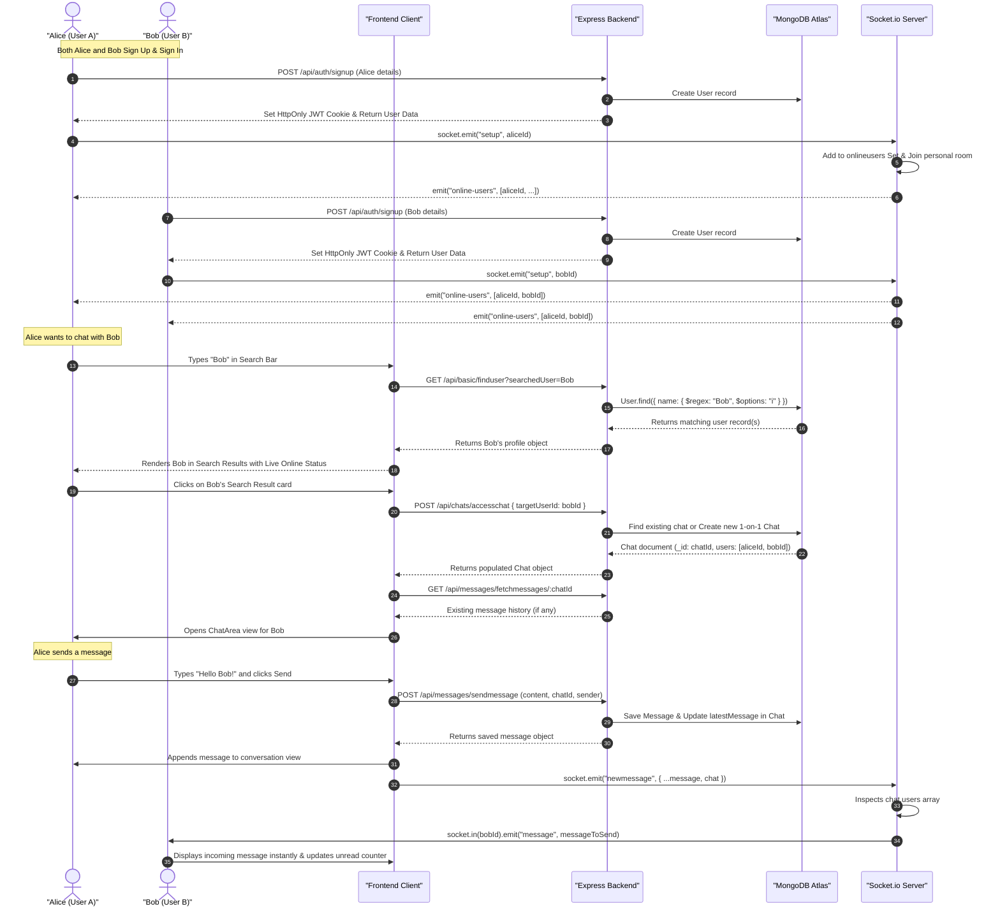
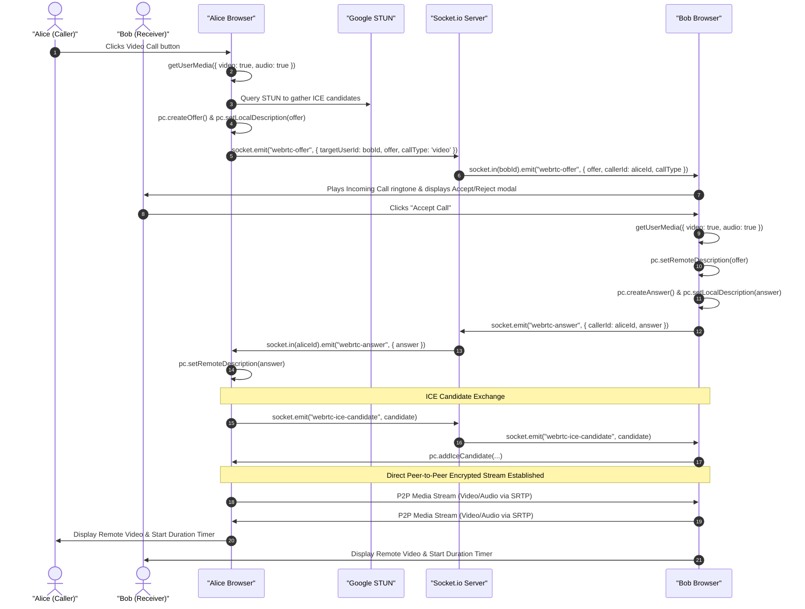

# ⚡ NeonChat — Real-Time Chat & Video Calling Application

[](https://react.dev/)
[](https://vitejs.dev/)
[](https://tailwindcss.com/)
[](https://nodejs.org/)
[](https://www.typescriptlang.org/)
[](https://socket.io/)
[](https://www.mongodb.com/)
[](https://webrtc.org/)

**NeonChat** is a modern, high-performance real-time messaging and peer-to-peer audio/video calling application built with **React 19**, **Express 5**, **TypeScript**, **MongoDB**, **Socket.io**, and **WebRTC**. It features a glassmorphic dark-neon user interface with real-time user presence tracking, instant user search & discovery, image sharing with Cloudinary integration, and peer-to-peer encrypted media streaming.

---

## 📑 Table of Contents

- [System Architecture](#-system-architecture)
- [Architecture Diagrams (Mermaid)](#-architecture-diagrams-mermaid)
  - [1. High-Level System Architecture](#1-high-level-system-architecture)
  - [2. User Discovery & Chat Initiation Sequence](#2-user-discovery--chat-initiation-sequence)
  - [3. WebRTC Audio & Video Calling Flow](#3-webrtc-audio--video-calling-flow)
- [Technologies Used](#-technologies-used)
  - [Frontend Stack](#frontend-stack)
  - [Backend Stack](#backend-stack)
  - [Database & Cloud Services](#database--cloud-services)
- [How to Use the App (User Guide & Workflow)](#-how-to-use-the-app-user-guide--workflow)
  - [Step 1: Account Creation & Sign In](#step-1-account-creation--sign-in)
  - [Step 2: Searching & Discovering Signed-Up Users](#step-2-searching--discovering-signed-up-users)
  - [Step 3: Accessing & Starting a 1-on-1 Chat](#step-3-accessing--starting-a-1-on-1-chat)
  - [Step 4: Real-Time Messaging & Image Attachments](#step-4-real-time-messaging--image-attachments)
  - [Step 5: Voice & Video Calling (WebRTC)](#step-5-voice--video-calling-webrtc)
  - [Step 6: Customizing Your Profile](#step-6-customizing-your-profile)
- [Project Directory Structure](#-project-directory-structure)
- [API & Socket.io Event Reference](#-api--socketio-event-reference)
  - [REST API Endpoints](#rest-api-endpoints)
  - [Socket.io Events](#socketio-events)
- [Local Setup & Installation](#-local-setup--installation)

---

## 🏛 System Architecture

NeonChat is architected with a decoupled **Client-Server model**:
1. **Frontend (SPA)**: Built using React 19 and Vite. Handles route management via React Router DOM v7, global authentication via `AuthContext`, real-time communication via `socket.io-client`, and peer-to-peer media streams through native browser `RTCPeerConnection`.
2. **Backend (API & Gateway)**: Built with Express 5 and TypeScript. Serves RESTful endpoints for authentication, chat management, message history, user profile queries, and image uploads (Multer + Cloudinary).
3. **Real-Time Layer**: Uses Socket.io to manage user socket rooms, broadcasts online/offline status, delivers real-time chat messages, typing status, and relays WebRTC signaling messages (offers, answers, ICE candidates).
4. **Database & Cloud Storage**: MongoDB stores collections for `User`, `Chat`, and `Message`. Cloudinary stores user profile pictures (with automatic facial centering) and image attachments sent in conversations.

---

## 📊 Architecture Diagrams (Mermaid)

### 1. High-Level System Architecture

```mermaid
flowchart TB
    subgraph ClientA["🖥️ Client A (Browser)"]
        UIA["Tailwind Glassmorphic UI"]
        AuthCtx["Auth Context (Session)"]
        SocketClientA["Socket.io Client"]
        WebRTCA["WebRTC PeerConnection"]
    end

    subgraph ServerLayer["⚙️ Backend Server (Node.js + Express 5 + TS)"]
        RESTRouter["Express REST API Router\n(/api/auth, /api/chats, /api/messages, /api/basic)"]
        AuthMW["JWT Cookie Middleware\n(HttpOnly Authentication)"]
        SocketServer["Socket.io Server\n(Signaling, Rooms & Presence)"]
        MulterStorage["Multer + Cloudinary Engine\n(Media Handling)"]
    end

    subgraph DataLayer["💾 Cloud & Data Services"]
        MongoDB[("MongoDB Atlas Database\n(Users, Chats, Messages)")]
        Cloudinary["Cloudinary CDN\n(Image & Avatar Storage)"]
        STUN["Google STUN Servers\n(NAT Traversal / ICE)"]
    end

    subgraph ClientB["🖥️ Client B (Peer Browser)"]
        UIB["Tailwind Glassmorphic UI"]
        SocketClientB["Socket.io Client"]
        WebRTCB["WebRTC PeerConnection"]
    end

    %% Client A Connections
    UIA -->|HTTP / Axios with Cookies| RESTRouter
    AuthCtx -->|Check Session /me| RESTRouter
    SocketClientA <-->|WebSocket Bi-directional| SocketServer

    %% Client B Connections
    UIB -->|HTTP / Axios with Cookies| RESTRouter
    SocketClientB <-->|WebSocket Bi-directional| SocketServer

    %% Backend Server to Data Services
    RESTRouter --> AuthMW
    AuthMW -->|Mongoose Queries| MongoDB
    RESTRouter -->|Mongoose Models| MongoDB
    MulterStorage -->|Uploads & Face-Crop Transformations| Cloudinary

    %% WebRTC Signaling & Peer-to-Peer Media
    WebRTCA <-->|STUN Candidate Discovery| STUN
    WebRTCB <-->|STUN Candidate Discovery| STUN
    WebRTCA <-->|Encrypted P2P Media Stream (SRTP)| WebRTCB
```

---

### 2. User Discovery & Chat Initiation Sequence

This diagram shows how users sign up, search for each other, and begin exchanging real-time messages:



---

### 3. WebRTC Audio & Video Calling Flow



---

## 🛠 Technologies Used

### Frontend Stack
| Technology | Version | Purpose |
| :--- | :--- | :--- |
| **React** | `^19.2.8` | Core UI library using modern functional components and hooks |
| **Vite** | `^8.2.2` | Ultra-fast development server and modern build toolchain |
| **React Router DOM** | `^7.18.2` | Declarative client-side routing with nested routes & route guards |
| **Tailwind CSS** | `^4.3.3` | Utility-first styling with custom glassmorphism, acrylic mesh & color tokens |
| **Socket.io Client** | `^4.8.3` | Real-time bi-directional event-based socket client |
| **Axios** | `^1.20.0` | Promise-based HTTP client configured for cross-origin credentials (`withCredentials`) |
| **WebRTC API** | Native Browser | Peer-to-peer audio and video communication |
| **Google Material Symbols** | Web Font | Modern iconography throughout headers, modals, and buttons |

### Backend Stack
| Technology | Version | Purpose |
| :--- | :--- | :--- |
| **Node.js** | `>=18.x` | JavaScript runtime environment |
| **Express** | `^5.2.1` | REST API framework for routing and middleware handling |
| **TypeScript** | `^7.0.2` | Strongly typed JavaScript for safer server codebase |
| **Socket.io** | `^4.8.3` | WebSockets server for rooms, presence, messaging, and signaling |
| **Mongoose** | `^9.9.3` | Elegant MongoDB object modeling for Node.js |
| **JSON Web Token (JWT)** | `^9.0.3` | Stateless authentication tokens stored in secure `HttpOnly` cookies |
| **BcryptJS** | `^3.0.3` | Password hashing with salt rounds |
| **Multer & Storage Cloudinary** | `^2.4.0` | Multipart/form-data handler for media file uploads |
| **Express Validator** | `^7.3.2` | Request body validation and sanitization middleware |
| **Cookie Parser** | `^1.4.7` | Parses cookies attached to client requests |
| **CORS** | `^2.8.6` | Configures secure Cross-Origin Resource Sharing with credentials |

### Database & Cloud Services
- **MongoDB Atlas**: Cloud-hosted NoSQL database storing user records, chat sessions, and message history.
- **Cloudinary**: Cloud media asset storage with on-the-fly transformations (e.g. automatic face detection & cropping for user avatars).
- **Google STUN Servers**: Public STUN infrastructure (`stun.l.google.com:19302`) for NAT traversal and candidate discovery in WebRTC sessions.

---

## 📖 How to Use the App (User Guide & Workflow)

### Step 1: Account Creation & Sign In
1. Navigate to the landing page or `/signup`.
2. Enter your **Full Name**, **Email**, and a **Strong Password** (minimum 6 characters, must contain at least 1 number and 1 special symbol).
3. Once registered, the backend creates your profile record in MongoDB and sets an authenticated `HttpOnly` session cookie.
4. If you already have an account, visit `/signin` to log in with your credentials.

---

### Step 2: Searching & Discovering Signed-Up Users
> [!IMPORTANT]
> **Why is my chat list empty after creating an account?**  
> When a new user signs up, they do not have any existing chat conversations yet. All users who have already registered exist in the database and can be found using the **Search feature**.

1. In the **Left Sidebar**, look for the **"Search chats..."** input bar.
2. Type any portion of a signed-up user's name (e.g., `"Alice"`, `"John"`).
3. The search runs dynamically against the database (`/api/basic/finduser?searchedUser=...`) using a case-insensitive regex query.
4. **All registered users matching the name will appear in the search results**:
   - Displays their avatar (or dynamically generated initials avatar).
   - Displays a live **Green Glowing Beacon** if the user is currently online.
   - Displays a grey dot if they are offline.

---

### Step 3: Accessing & Starting a 1-on-1 Chat
1. Click on the desired user from the search results.
2. The application automatically triggers `/api/chats/accesschat` with the selected user's ID:
   - If you have chatted before, it loads your existing conversation.
   - If it is your first time chatting, it creates a brand new 1-on-1 chat room in MongoDB.
3. The URL navigates to `/dashboard/chat/:targetuserId`.
4. The central **ChatArea** loads the chat history, and the user is added to your active chat list in the sidebar.

---

### Step 4: Real-Time Messaging & Image Attachments
1. **Send Messages**:
   - Type your message into the bottom input field.
   - Press <kbd>Enter</kbd> or click the neon **Send** button.
   - The message is saved in MongoDB and immediately broadcast over Socket.io to the recipient's personal room.
2. **Send Photos / Images**:
   - Click the attachment icon to select an image file from your computer.
   - A live thumbnail preview appears above the input box.
   - When sent, the image is uploaded to **Cloudinary** and delivered as a high-resolution preview in the conversation.
3. **Unread Badges & Mark-as-Read**:
   - If someone sends you a message while you are in another chat, an unread counter badge appears next to their name in the sidebar.
   - Opening that chat automatically marks all incoming messages as read via `/api/messages/mark-read`.

---

### Step 5: Voice & Video Calling (WebRTC)
1. **Initiate a Call**:
   - Open a chat with any contact.
   - In the chat header, click either the **Videocam** (Video Call) or **Call** (Voice Call) icon.
2. **Incoming Call**:
   - When a call arrives, a full-screen or banner prompt rings with an authentic ringtone.
   - The recipient can click **Accept** to connect or **Reject** to decline.
3. **During the Call**:
   - Both participants' video/audio streams connect peer-to-peer.
   - Features include a live **Call Duration Timer**, **Mute Audio**, **Toggle Video Camera**, and **Switch Camera** (for mobile devices).
   - Click the red **End Call** button to hang up and notify the other party.

---

### Step 6: Customizing Your Profile
1. In the left sidebar header, click the **three dots** menu (`more_vert`).
2. Select **Edit Profile**:
   - Update your **Display Name**.
   - Customize your **Status / Bio**.
   - Upload a new **Profile Picture** (automatically cropped and centered using Cloudinary AI face detection).
3. Click **Save Changes** to update your global profile.

---

## 📁 Project Directory Structure

```text
chat-app/
├── chat-backend/                       # Express + TypeScript Backend
│   ├── src/
│   │   ├── config/
│   │   │   ├── cloudinary.ts           # Cloudinary SDK credentials & setup
│   │   │   └── multerConfig.ts         # Multer Cloudinary storage engine
│   │   ├── controllers/
│   │   │   ├── authcontroller.ts       # Signup, Signin, Logout & JWT cookies
│   │   │   ├── basiccontroller.ts      # finduser (Search), userdetails, updateprofile
│   │   │   ├── chatcontroller.ts       # accessChat, fetchChats, unreadCount aggregation
│   │   │   └── messagecontroller.ts    # sendMessage, fetchMessages, markMessagesAsRead
│   │   ├── middleware/
│   │   │   └── mockAuth.ts             # JWT token verification from HttpOnly cookie
│   │   ├── models/
│   │   │   ├── user.model.ts           # User schema (name, email, passwordHash, avatar, bio)
│   │   │   ├── chat.model.ts           # Chat schema (chatName, isGroupChat, users, latestMessage)
│   │   │   └── message.model.ts        # Message schema (sender, content, chat, readBy, image)
│   │   ├── routes/
│   │   │   ├── authrouter.ts           # /api/auth routes
│   │   │   ├── basicrouter.ts          # /api/basic routes (finduser, userdetails)
│   │   │   ├── chatrouter.ts           # /api/chats routes
│   │   │   └── messegerouter.ts        # /api/messages routes
│   │   └── server.ts                   # Express server, Socket.io event & WebRTC signaling gateway
│   ├── .env                            # Backend environment configuration
│   ├── package.json
│   └── tsconfig.json
│
└── chat-frontend/                      # React 19 + Vite Frontend
    ├── src/
    │   ├── assets/                     # Sound effects, ringtones & static assets
    │   ├── components/
    │   │   ├── Chat.jsx                # Sidebar chat item card with unread count & online status
    │   │   ├── ChatArea.jsx            # Main conversation view, messages list, input & call modal
    │   │   ├── GuestRoute.jsx          # Route guard redirecting authenticated users to /dashboard
    │   │   ├── LandingPage.jsx         # Modern landing page showcasing app features
    │   │   ├── MobileNav.jsx           # Responsive mobile top navigation
    │   │   ├── ProfileDetailsModal.jsx # Profile edit modal (name, bio, Cloudinary avatar upload)
    │   │   ├── ProtectedRoute.jsx      # Route guard redirecting unauthenticated users to /signin
    │   │   ├── Rmessage.jsx            # Incoming (received) message bubble component
    │   │   ├── Schat.jsx               # Search result user card with live online indicator
    │   │   ├── SidebarLeft.jsx         # Left panel: search input, chat list, tabs & user status
    │   │   ├── SidebarRight.jsx        # Right panel: target contact info, bio & actions
    │   │   ├── Signin.jsx              # Sign In page with glassmorphism card
    │   │   ├── Signup.jsx              # Sign Up page with credentials validation
    │   │   ├── Smessage.jsx            # Outgoing (sent) message bubble component
    │   │   └── VideoCall.jsx           # WebRTC P2P audio/video calling overlay with STUN & timers
    │   ├── context/
    │   │   └── AuthContext.jsx         # Global user authentication state via /api/auth/me
    │   ├── lib/
    │   │   └── socket.js               # Global Socket.io client instance & online users cache
    │   ├── services/
    │   │   ├── Authservice.js          # Axios API calls for signup, signin, logout, getCurrentUser
    │   │   └── Chatservice.js          # Axios API calls for chats, messages, searchuser, profile
    │   ├── App.css                     # Tailwind v4 theme definitions, fonts & glass utilities
    │   ├── App.jsx                     # Dashboard shell layout (SidebarLeft + Outlet + SidebarRight)
    │   └── main.jsx                    # React Router DOM route definitions and root mount
    ├── index.html
    ├── package.json
    └── vite.config.js
```

---

## 🔌 API & Socket.io Event Reference

### REST API Endpoints

| Method | Endpoint | Auth | Description |
| :--- | :--- | :---: | :--- |
| `POST` | `/api/auth/signup` | No | Registers a new user and sets HttpOnly JWT cookie |
| `POST` | `/api/auth/signin` | No | Authenticates user credentials and sets HttpOnly JWT cookie |
| `POST` | `/api/auth/logout` | No | Clears the session cookie |
| `GET` | `/api/auth/me` | Yes | Retrieves the authenticated user's current session |
| `GET` | `/api/basic/finduser?searchedUser=:name` | Yes | Searches all signed-up users by name using regex |
| `POST` | `/api/basic/userdetails` | Yes | Retrieves user details for a given target user ID |
| `PUT` | `/api/basic/updateprofile` | Yes | Updates current user's name, bio, and profile picture |
| `POST` | `/api/chats/accesschat` | Yes | Fetches or creates a 1-on-1 chat with `targetUserId` |
| `GET` | `/api/chats/fetchchats` | Yes | Retrieves all chats for the user sorted by newest activity |
| `POST` | `/api/messages/sendmessage` | Yes | Sends a text message or image attachment (`multipart/form-data`) |
| `GET` | `/api/messages/fetchmessages/:chatId` | Yes | Retrieves message history for a given chat room |
| `PUT` | `/api/messages/mark-read` | Yes | Marks unread messages in a chat as read by current user |

### Socket.io Events

| Event Name | Direction | Payload | Description |
| :--- | :--- | :--- | :--- |
| `setup` | Client ➔ Server | `userId` | Registers the user's socket and joins their personal room |
| `connected` | Server ➔ Client | None | Confirms successful socket initialization |
| `online-users` | Server ➔ Client | `string[]` (User IDs) | Broadcasts active online user IDs to all connected clients |
| `join chat` | Client ➔ Server | `chatId` | Joins a specific chat room |
| `typing` | Client ➔ Server | `{ room, userName }` | Broadcasts typing indicator to other room members |
| `stop typing` | Client ➔ Server | `{ room }` | Dismisses typing indicator |
| `newmessage` | Client ➔ Server | `MessageObject` | Emits a newly posted message to the server for distribution |
| `message` | Server ➔ Client | `MessageObject` | Delivers real-time message to recipient's personal room |
| `webrtc-offer` | Client ⇄ Server | `{ targetUserId, offer, callType }` | WebRTC SDP offer signaling for voice/video calls |
| `webrtc-answer` | Client ⇄ Server | `{ callerId, answer }` | WebRTC SDP answer signaling |
| `webrtc-ice-candidate` | Client ⇄ Server | `{ targetId, candidate }` | WebRTC ICE candidate network relay |
| `webrtc-end-call` | Client ➔ Server | `{ targetId }` | Terminates an ongoing call session |
| `webrtc-call-ended` | Server ➔ Client | None | Informs peer that the call has been hung up |

---

## 🚀 Local Setup & Installation

### Prerequisites
- [Node.js](https://nodejs.org/) (v18 or higher)
- [MongoDB](https://www.mongodb.com/) (Local instance or free MongoDB Atlas URI)
- [Cloudinary](https://cloudinary.com/) free account for media storage

---

### 1. Backend Setup

1. Open your terminal and navigate to `chat-backend`:
   ```bash
   cd chat-backend
   ```
2. Install dependencies:
   ```bash
   npm install
   ```
3. Create a `.env` file in the `chat-backend` root directory with the following variables:
   ```env
   PORT=5000
   MONGO_URI=your_mongodb_connection_string
   JWT_SECRET=your_super_secret_jwt_key
   NODE_ENV=development
   CLIENT_URL=http://localhost:5173
   CLOUDINARY_CLOUD_NAME=your_cloudinary_cloud_name
   CLOUDINARY_API_KEY=your_cloudinary_api_key
   CLOUDINARY_API_SECRET=your_cloudinary_api_secret
   ```
4. Start the backend development server:
   ```bash
   npm run dev
   ```
   The backend will start on `http://localhost:5000` and connect to MongoDB.

---

### 2. Frontend Setup

1. Open a second terminal window and navigate to `chat-frontend`:
   ```bash
   cd chat-frontend
   ```
2. Install dependencies:
   ```bash
   npm install
   ```
3. (Optional) If running against a local backend, ensure `Chatservice.js`, `Authservice.js`, and `socket.js` point to `http://localhost:5000` or configure an environment variable.
4. Start the Vite development server:
   ```bash
   npm run dev
   ```
5. Open your browser and navigate to:
   ```text
   http://localhost:5173
   ```

---

## 💡 Quick Start Walkthrough

1. Open `http://localhost:5173` in a normal browser window and click **Sign Up** to create an account for **"Alice"**.
2. Open an **Incognito / Private** browser window, go to `http://localhost:5173`, and create an account for **"Bob"**.
3. In Alice's window, type **"Bob"** in the **Search Bar** in the sidebar. Bob will immediately appear with a green online pulse.
4. Click on Bob's card to open a chat.
5. Send a message or photo from Alice — Bob will receive it in real-time with an unread badge!
6. Click the **Video Call** icon in the chat header to test WebRTC peer-to-peer calling between the two browser tabs.

---

## 📄 License
This project is open-source and available under the [MIT License](LICENSE).
